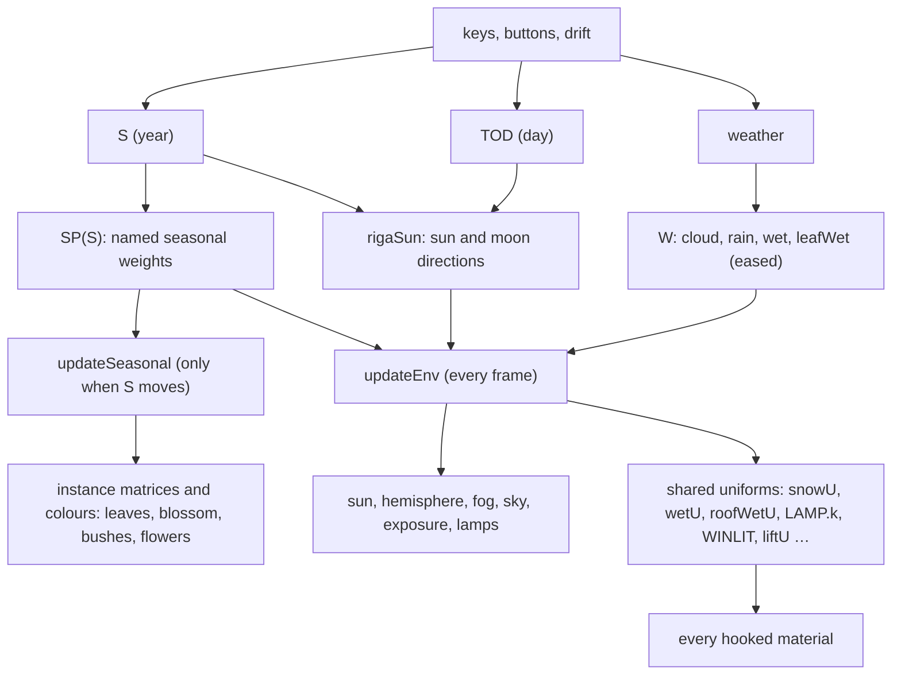
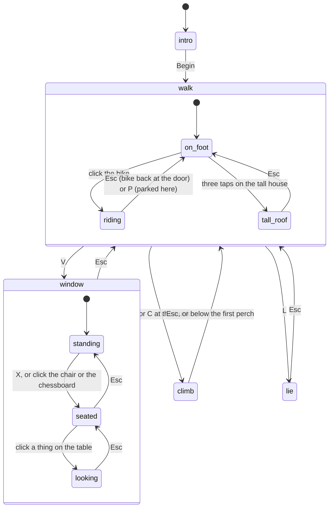

# Architecture

How Kashtan is put together, as of November 2026.

Line numbers below are approximate and drift with every change. Each section of `index.html` opens with a banner comment
(`/* ====== name ====== */` for the big ones, `/* ---------- name … */` for the parts inside them), so search for the banner.

## At a glance

- **One page, no build step.** The whole game is `index.html`: about 11,000 lines and 1.4 MB, of which the first hundred are the
  HTML and CSS of the overlay and the rest is a single `<script type="module">`.
- **Three.js 0.160 from unpkg**, through an import map. The page also imports `mergeGeometries` / `mergeVertices` / `toCreasedNormals` from the addons,
  and fetches `GLTFLoader` and the meshopt decoder only when the room needs the figurine.
- **Everything is made in code at load time.** Geometry is built vertex by vertex, every texture is painted on a canvas, and all
  sound is synthesised with the Web Audio API. The one binary asset is `models/bather.glb` (the porcelain figurine on the table).
  Besides that, the only download is the Google Fonts stylesheet.
- **Deterministic.** One seeded random stream builds the same world on every load.
- **No server and no saved game.** The only thing kept between visits is the language, in `localStorage['kashtan-lang']`.
- **Hosting.** It is published as static files on GitHub Pages (https://rioffe.github.io/kashtan/). Locally, serve the folder
  (`python3 -m http.server 8765`), because a browser won't fetch the `.glb` for a page opened as a file.

## Files

| Path                | What it is                                                              |
|---------------------|-------------------------------------------------------------------------|
| `index.html`        | the game                                                                |
| `models/bather.glb` | the *Young bather* figurine (1.3 MB, meshopt-compressed, ~90k triangles) |
| `README.md`         | for players: what there is, the controls, the three-tap secrets         |
| `setting.md`        | the original brief                                                      |
| `ARCHITECTURE.md`   | this file                                                               |

## Map of `index.html`

The script runs from top to bottom, and the sections below are in that order.

| Line   | Banner                                    | What's there |
|-----:|---------------------|--------------------------------------|
| 1      | `<head>`, `<body>`                        | CSS; the import map; the DOM overlay (title card, HUD, caption, button bar, touch controls, fade) |
| 118    | utilities                                 | seeded RNG (`rng`, `rnd`, `pick`, `mkRng`), math (`clamp`, `smooth`, `lerp`, `wrapA`, `yawTo`), noise (`vnoise`, `fbm`, `stainNoise`), `tex()`, `phoneSized`, `spent`, the window-light ranks (`rankAlpha`, `winLit`, `winShare`), canvas painters (`stains`, `reflect`) |
| 212    | renderer                                  | `renderer`, `scene`, `camera`; the shared uniforms; the base material hooks (`snowify`, `swayify`, `bendify`) and several chained ones (`roofWear`, `wetRoof`, `leafGlow`, `leafWet`); chimneys |
| 419    | textures                                  | shared canvas textures: grass, dirt, bark, the blossom candles, `dotTex` (the soft dot every particle uses), flame |
| 655    | world layout                              | the coordinates and dimensions everything else reads; the region tests (`inHome`, `onStreet`, `synWalk`, `inChurch`); the street lamps (`LAMP`, `lampLit`) |
| 774    | lights & sky                              | hemisphere light, `sun` plus the far shadow map (`sunFar`) and its `ShaderChunk` patch; sky dome; stars |
| 828    | ground & road                             | the ground, the lane, verges |
| 977    | the building                              | the apartment house, its entrances and windows, the entrance lamp; then paths and overgrowth |
| 1386   | my room                                   | the room behind the third-floor window: furniture, books, desk lamp, calculator, Easter cactus, figurine, Salvo Ferrari, Dad's chess set; desk views; picking |
| 2371   | the chestnut tree                         | branch growth, leaves, blossom candles, husks, leaf litter, the climbing perches (`PERCH`) |
| 2740   | the road: garages                         | the garage row |
| 2816   | gardens                                   | plots, sheds, orchard, the leafy bushes (`LEAFY`), fruit trees, beds and crops, the rowan, the workshops |
| 4017   | what you can stand on                     | `surf()`, `bedY()`, `catSurf()`, ladders |
| 4049   | Virginia creeper … snowmen                | the creeper, lying snow, flowers (`FLORA`), peonies and dahlias (`BORDER`), bulbs, snowmen |
| 5235   | the old city                              | the Art Nouveau facade sheet (`AN`), houses assembled from it, balconies, `buildBlock` over the grid; the back lots |
| 6790   | St. Gertrude's                            | the church, its square and lindens, `CHURCH_CLOCK` |
| 7399   | the Great Choral Synagogue                | the synagogue, its yard, railing and lindens |
| 8140   | smoke from the chimneys                   | `CHSMOKE` |
| 8193   | weather                                   | clouds, rain, puddles, `updateWeather` |
| 8319   | icicles                                   | |
| 8360   | particles & creatures                     | `class Fall`, snowfall, fireflies, falling leaves, chestnuts, birds, the fire; fallen leaves and `LEAFCOV` |
| 8893   | the neighbourhood cat                     | `cat`, `POSES`, `catEpisode`, `catRoute`, `updateCat` |
| 9338   | my Orlyonok                               | the bicycle, `BIKE` |
| 9930   | season & time                             | `S`, `TOD`, the sun over Rīga, `SP()`, colour keys, `WEATHERS`, `updateEnv`, `updateSeasonal` |
| 10086  | camera & controls                         | `mode`, input handlers, `setMode`, `goBack`, climbing, jumping, the tall house's roof |
| 10280  | interactions                              | `shake` (kick the trunk), `roast` |
| 10302  | audio                                     | `sfx` |
| 10455  | UI / languages                            | `I18N`, `tr`, `caption`, the button bar, HUD, `syncButtons`, `syncCtx` |
| 10659  | touch                                     | the stick and buttons |
| 10677  | begin                                     | the Begin button |
| 10686  | main loop                                 | `walkStep`, `freeCanvases`, `frame()`, the URL debug harness, start-up |

## Lifecycle

### Load

Nearly all of the script is top-level code that builds something and adds it to `scene` when it is reached. There is no asset
pipeline and no asynchronous world building, so by the last line of the script the whole town exists. Source order is
execution order, and that matters for the random stream (see [The seeded world](#the-seeded-world)).

Function declarations are hoisted, which is why a hook like `shaderChain` (defined around line 4239) can be used by `winLit`
near the top of the file.

The last lines call `setLang(LANG)`, `updateNutHUD()` and `syncButtons()`, then start the loop with `frame()`. While the title
card is up, `mode` is `'intro'` and the camera circles the tree.

### Begin

The Begin button sets `started`, starts the audio (an `AudioContext` needs a user gesture), hides the title card, and fades to
the player standing on Stabu iela in front of the gateway.

### The first frame

The first call to `frame()` runs `freeCanvases()`. It collects every canvas texture used by a material in the scene, uploads
each to the GPU with `renderer.initTexture`, then shrinks its canvas to 1×1 so the browser can free the pixels. That is what lets
a phone hold the town (see [Devices and memory](#devices-and-memory)). The cost is that the textures can't be uploaded again, so
if the WebGL context is lost (iOS does this to pages in the background) the page reloads itself.

### Every frame

`frame()` does this, in order:

1. Clamps `dt` to 50 ms and sets `timeU`, the clock all shaders see.
2. Moves the year and the day: either drift, or ease `S` toward `sTarget` and `TOD` toward `todTarget`. Then it ages the cactus,
   sets St. Gertrude's clock hands, and recomputes the button times for the date (`rigaTimes`).
3. Computes `sp = SP(S)`, then calls `updateSeasonal(sp)` (which does nothing unless `S` has moved), `updateEnv(sp)` (sun, sky,
   fog, lights and the shared uniforms), `updateSeasonHUD()` and `updateCandles(t)`.
4. Moves the camera for the current mode (see [The player](#the-player)).
5. Keeps the sky dome and stars centred on the camera, and shows the room only when the camera is in it or close by.
6. Runs the tree shake; spawns falling leaves, chestnuts and petals; updates the particle systems; runs the per-frame LOD (sets
   `lodU.eye` and calls each `lod()`); advances chess playback, the bike, falling petals and chimney smoke.
7. Runs the weather (`updateWeather`), picks random weather while drifting, and moves the snowfall around the camera.
8. Updates the fireflies, the falling and fallen leaves, chestnut gathering, birds, the cat, snowmen, the window sashes, and the
   lit window as seen from outside.
9. Updates the fire and its sparks.
10. Calls `syncCtx()` for the context buttons, applies any debug overrides, and sets the leaf-glow uniforms.
11. Calls `CHESS.reflect()`, which renders the pieces into a small render target for the board's lacquer, then
    `renderer.render(scene, camera)`.

## The state that drives everything

### The year: `S`

`S` is a float in [0, 4). 0 is the middle of December, each whole unit is a season (winter, spring, summer, autumn), and a month
is a third of a unit. The season buttons go to `SEASON_MID`.

Nothing decides what is in bloom by comparing `S` with a date. Instead, `SP(S)` returns a profile of named weights in [0, 1]:
`snow`, `leaf`, `blossom`, `snowfall`, `birds`, `veg`, `flowers`, `sunfl`, `lilac`, `fireflies`, `petals`, `husk`, `litter`,
`nutfall` and `leaffall`. Each is a smooth trapezoid built by `bump(s, a, b, c, d)`. Colours that change through the year
interpolate keyframes with `cyc(S, keys)` (`groundKeys`, `shrubKeys`, …). Systems with timings of their own, such as a bush's
leafing and turning or one flower's season, call `bump()` with their own breakpoints.

### The day: `TOD`

`TOD` is a float in [0, 1): the time on a Rīga clock in 1984. That is Moscow time, with summer time from 1 April to 30
September. `rigaSun(S, hour)` gives the true sun direction at 56.95° N for that date and hour, and `rigaTimes` sets the
Dawn / Day / Dusk / Night buttons from that day's sunrise and sunset, so Dusk falls at a different hour in December than in June.
The moon's direction is derived from the sun's. `env` holds `e` (the sine of the sun's elevation), `day` and `night` (each 0–1).

### The weather

`weather` is the chosen name: `fair`, `cloudy` or `rain`. `WEATHERS` holds each one's targets, and `W` holds the eased actual
state: `cloud` and `rain`; `wet`, the ground, which dries slowly; `leafWet`, which dries faster; and `drip`. `updateWeather` eases
these and moves the clouds, rain and puddles. In deep winter the rain button brings heavy wet snow.

### Drift

The Drift button advances `S` by one season every 150 s (a year in ten minutes) and `TOD` by one day every 240 s, and picks new weather
every 45–100 s.

## Rendering

### Renderer, camera, sky

- `WebGLRenderer` with antialiasing, ACES filmic tone mapping and PCF soft shadows. The pixel ratio is capped at 2, or 1.5 on
  touch screens.
- One `PerspectiveCamera`: 62°, near 0.1, far 2500, Euler order `YXZ`. The player's view is `cam.yaw` / `cam.pitch`. At the desk
  the camera instead orbits a target (`desk.views[…]`).
- `FogExp2`, its colour and density following the sky, snow, night and rain.
- The sky is an 1800 m sphere with a gradient shader (horizon to zenith by the sun's elevation, a sun disc and glow, the moon)
  that follows the camera, plus two `Points` star fields.

### Sun, moon and two shadow maps

One `DirectionalLight`, `sun`, is the sun by day and the moon by night. Its 2048² shadow map covers 96 m around a point 18 m
ahead of the camera (pulled toward the tree when you are near it). The map moves only in whole texels, so shadows don't shimmer
as you walk.

A second directional light, `sunFar`, has zero intensity and exists only for its shadow map: 4096² (2048² on phones) over 520 m,
re-rendered only when its snapped centre or the sun moves (`shadow.autoUpdate = false`). The two maps are blended by a patch to
`THREE.ShaderChunk.lights_fragment_begin`, applied at start-up. With two shadowed directional lights, light 0 uses the near map,
falls back to the far map over the near map's outer tenth, and light 1 adds nothing. The patch matches the chunk's exact text in
Three 0.160. If the text ever differs, the console warns `far shadows: the lights chunk has changed` and the far map goes unused.

The entrance lamp is a real `PointLight` whose shadow is re-rendered at most once a second.

### Material hooks

Most of the look comes from small GLSL patches injected into Three's standard materials through `onBeforeCompile`. They are
written as decorators that take a material and return it, for example
`wetRoof(snowify(new THREE.MeshStandardMaterial({ … })))`.

There are two kinds:

- **Base hooks** assign `onBeforeCompile` outright, replacing whatever was there: `snowify`, `swayify`, `bendify`. Apply them
  first (innermost).
- **Chained hooks** wrap the existing hook and extend `customProgramCacheKey`. `shaderChain(mat, key, fn)` is the general helper;
  `leafGlow`, `leafWet` and `lodify` chain by hand in the same way.

| Hook | What it does |
|------|--------------|
| `snowify(mat, k)` | whitens faces that point up, by `snowU`; declares `vSnowN` |
| `swayify(mat, amp, flut)` | sways instanced foliage in the wind (`windU`, `timeU`), optionally with leaf flutter; adds `liftU` |
| `bendify(mat, amp, lift)` | bends each plant from its base (`aBase` instance attribute, set by `bendBases`) |
| `roofWear(mat)` | tin sheets, standing seams, rust and grime laid out in world space, so no two roofs match |
| `wetRoof(mat, k, flatPud)` | wet darkening, gloss, sky sheen, raindrop rings, puddles on flat roofs (needs `snowify`'s `vSnowN`) |
| `leafGlow(mat)` | light through leaves when the sun is behind them (`leafU`) |
| `petalGlow`, `flowerify` | the same, gentler, for petals; flowers opening toward their centres |
| `leafWet(mat, drops, onGround)` | wet leaves: darker, glossy, with beads of water near the eye (`wetU`) |
| `lodify(mat, near)` | collapses instances nearer or farther than `lodU.d` from `lodU.eye` |
| `leafCover(mat)` | discards plant fragments that would poke up through a fallen leaf (`LEAFCOV`) |
| `lampLit(mat)` | street-lamp light, computed in the shader (below) |
| `winLit(mat, lod0, seedCol)` | lights windows one at a time by the hour (below) |
| `keepAlpha(mat)` | keeps thin alpha-tested bars (railings) from vanishing at distance |

Rules for hooks:

- They patch Three's shaders by string-replacing chunk includes such as `#include <color_fragment>`,
  `#include <emissivemap_fragment>`, `#include <roughnessmap_fragment>`, `#include <project_vertex>` and
  `#include <worldpos_vertex>`. All of these are Three 0.160's. Upgrading Three means checking each one.
- Any value baked into the GLSL text must be part of the cache key. Otherwise Three reuses a program compiled for a different
  variant. The existing hooks follow this (`'wetRoof' + k + …`, `'winLit' + lod0 + seedCol`).
- Uniform values are shared objects: `snowU`, `timeU`, `windU`, `liftU`, `wetU`, `roofWetU`, `roofRainU`, `leafU`, `lodU`,
  `LAMP.k`, `WINLIT`, `LEAFCOV.lit`. Every material holds a reference to the same object, so `updateEnv` or `frame` sets each value
  once and every material sees it.

### Light without lights

There are hundreds of street lamps and thousands of windows, far too many for Three's lights.

- **Street lamps.** There is one over every crossing and one halfway along every block. `lampLit(mat)` adds a loop to the fragment
  shader: from the fragment's world position it finds the nearest lamps on three lattices `CELL` apart (2×2 cells on each),
  skips the places that have no lamps (our yard, the church square, the synagogue's sides), and adds every lamp within 32 m as a
  direct light. Which lamps are dead (one in 29) and which flicker (one in 31) is the same hash in GLSL (`LAMP_GLSL`) and in
  JavaScript (`LAMP.dead`, used for the lamp heads' glow). If you change one, change both. The `[` / `]` debug panel scales
  `LAMP.b`.
- **Windows.** Each window that can light gets a turn, a rank from 0 to 1, written into the alpha channel of its material's
  emissive texture (`rankAlpha`). `WINLIT.value` is the share of windows lit at this hour: `winShare` estimates who is home and
  awake, times how dark it is. `winLit(mat)` lights a window once the share passes its rank. At a distance, where mip levels blur
  the windows together, it fades to the average.

### Procedural textures

`tex(w, h, draw, opts)` makes a canvas, lets `draw(g, w, h)` paint it with the 2D canvas API, shrinks it on phones if it is over
2048 px, and wraps it in a repeating sRGB `CanvasTexture`. The painters shared across the file are `speckle`, `blot`, `stains`
(layered value noise drawn at quarter resolution, used for damp, soot, rust and moss) and `reflect` (what a window pane mirrors).
The town's houses all share one 4096×2048 sheet of fifteen facade designs, `AN`, plus masks for glass, storey and tint.

Because `freeCanvases` discards the canvases after the first frame, textures are painted once, at load, and never redrawn.
Whatever changes at runtime changes through uniforms, instance attributes or a `DataTexture` (`LEAFCOV`).

### Geometry, instancing and LOD

- Buildings and street furniture are built as raw vertex lists, `{ p, n, uv, c, i }` arrays filled by helpers such as `cface` and
  `chimneyInto`, and turned into a few large `BufferGeometry` meshes. `mergeGeometries` joins parts. `spent(...)` empties the
  source arrays once a geometry is made, so they aren't kept twice.
- Anything numerous is an `InstancedMesh`: the chestnut's leaves and blossom, every bush's shoots, flowers, fruit, falling leaves,
  chimney smoke. Seasons change these by rewriting instance matrices (scale 0 hides one) and instance colours.
- LOD has two halves. In the shader, `lodify` draws an instance only on one side of `lodU.d` (12 m) from `lodU.eye`, so a plant can
  have a detailed near mesh and a cheap far mesh drawn from the same instance list. On the CPU, systems split into spatial blocks
  expose `lod()`, called every frame, which hides the near meshes of blocks out of range. Many fine details (roof seams, raindrop
  rings, beads on leaves) also fade with distance inside their shaders.

### Particles and falling things

`class Fall` is a ring-buffer `Points` system with gravity, sway and wind. Its instances are `petals` (blossom), `snowPuff` (snow
shaken off the tree) and `sparks` (the fire). Snowfall and fireflies are their own `Points` fields around the camera.

Falling leaves are instanced meshes: `fallAir` while in the air, `fallDown` once landed. A leaf comes to rest on whatever is under
it (`layFallen`) and stamps itself into `LEAFCOV`, a float `DataTexture` covering 30 m around the tree. `leafCover` reads it so
grass and dandelions don't poke through.

## The world

### Coordinates

Units are metres. x is east, y is up, z is south, so north is −z.

| Constant | Value | What it is |
|----------|-------|------------|
| `TREE` | (12, 0, −137) | the chestnut |
| `BZ` | −150 | the apartment building's front face |
| `HOME` | (5.4, 8.95, −150) | my window, third floor, centre right |
| `ROAD_X` | −8.4 | the lane, running north from Stabu iela to the courtyard |
| `STABU_FRONT`, `STABU_FAR` | −45, −30 | the Stabu house fronts on our side and across the street |
| `GATE_X0`, `GATE_X1` | −11.1, −4.7 | the gateway through the Stabu houses, the only way between the yard and the town |

The town is a grid of blocks, `BLOCK = 44` m square on a `CELL = 59` m pitch, with 15 m streets between the house fronts.
`bx0(gx)` and `bz0(gz)` give a block's lowest x and z. Our home block is 3×3 cells with no streets through it (`homeCell`,
`inHome`). `blockOn(gx, gz)` says which cells have houses, out to about 440 m. St. Gertrude's (`CHURCH_SQ`) and the synagogue
(`SYN`) take over cells of their own, and the cobbled street behind ours is 5 m wider (`WIDE`). All of these live in *world
layout*, and the later sections read them, so change them there.

### The seeded world

All of the world's randomness comes from `rng()` (and `rnd`, `pick`), a single global stream seeded with 1984 and drawn in
source order while the world is built. Adding or removing a single draw moves every house, flower and cloud built after it. The
code guards against this in two ways, and new code should too:

- Self-contained systems use their own generator, `mkRng(seed)` (there are over a hundred), or their own hash (`stainNoise`, "so
  the world's sequence is untouched").
- Where a section's number of draws had to change, it saves `seed`, does its work, and restores or fast-forwards it. The town
  does both: the near blocks draw from the world's stream, which is then advanced by exactly the count it had before the blocks
  were resized (`seed = sv + Math.imul(11561, 0x6D2B79F5)`), and the far blocks use a seed of their own (19841117).

New building code should take its own `mkRng`. Calls to `rng()` from runtime code (picking a caption, spawning a leaf) don't
matter, because by then the world is built.

### How the big systems are organised

- **The tree.** A recursive `grow()` lays down branch segments and collects `tree.tips`. The tips seed `LEAVES`, `CANDLES`
  (blossom) and `HUSKS`. `LITTER` is the leaf carpet. `PERCH` lists the places you can climb to, some with a path along the branch.
- **Bushes and fruit trees.** These are `LEAFY`: lilac, hazel, elder, mock orange, currant, gooseberry, apple, pear, plum and
  the rowan, their blossom and berries, and the beds' crops (`VEG`). They come from a few shared factories, and each instance
  exposes `update(S)` and `lod()`.
- **Flowers.** `FLORA`, `BORDER` (peonies and dahlias), `TOMATO`, `GLAD`, `PANSY`, `MARIGOLD` and the bulbs, each with its own
  `update(S)`.
- **The town.** `AN` is the facade sheet, and `buildBlock(gx, gz)` puts each block together (`townBlock` for houses, `ghostBlock`
  for the cells given to the landmarks). `EAVES` keeps every house's box and roof. It is used for picking the tall house and for
  walking on its roof.
- **The landmarks.** St. Gertrude's and the synagogue are each built from a plan in local (u, v) metres around their middles.

### Seasonal updates

`updateSeasonal(sp)` returns immediately unless `S` has moved more than 0.0015 since its last run. When it does run, it rescales
and recolours the tree's leaves, candles and husks (a husk that passes its drop time falls as a chestnut), updates the icicles and
the leaf litter, and calls every garden system: `updateOrchard` (which also updates `LEAFY`), `updateVines`, `updateTufts`,
`updateDandelions`, `updateBulbs`, `FLORA.update(S)`, `BORDER.update(S)`, `TOMATO`, `GLAD`, `PANSY`, `MARIGOLD`, and the lilac
blossom. Each `update(S)` remembers its last input and returns early when nothing would change.

To add something seasonal, follow the same pattern:

1. Build it once at load, with all of its instances.
2. Give it an `update(S)` that sets instance scales and colours from `bump()` weights, and call it from `updateSeasonal`.
3. If it has near and far meshes, add its `lod()` to the per-frame line in `frame()`.

## The player

### Modes

`mode` is one of `'intro'`, `'walk'`, `'window'`, `'climb'` or `'lie'`. Debug views also use `'free'`, which no code handles, so
the camera stays where it was put. Some state lives inside a mode:

- **In `walk`:** `BIKE.riding`; `body.roof`, set while on the tall house's roof; `body.mantle`, set while clambering onto
  something; `body.vy`, while jumping or falling.
- **In `window`:** `desk.on`, set while sitting at the table or on the sofa; `desk.f`, the object being looked at; `winOpen`, the
  sash.
- **In `climb`:** `perch`, an index into `PERCH`, and the offset along the branch on perches that have one.

`setMode(m)` makes the transitions. Short moves tween the camera (`goTo`, eased over about two seconds), and moves between
distant places fade to black and jump (`fadeThen` calling `place`). `goBack()` is the one "back" action, bound to Esc, G and
the touch screen's back button. It unwinds the innermost state first: the chess position, then the desk view, then standing up,
getting off the bike, coming down from the roof, and finally back to walking.

### Walking and collision

`walkStep(dt, mx, mz, speed)` moves the player on foot. It uses no physics engine and no collision meshes:

- **Ground height is a function.** `surf(x, z)` returns the height of the highest surface you can stand on at that point: garage
  roofs, workshop roofs, sheds, the synagogue's steps, and the Stabu houses as a 40 m wall. It also sets the global `surfKind`
  (`ground`, `tar` or `tin`), which picks the footstep sound.
- **Moves are taken one axis at a time.** A move is refused if the surface ahead is more than 0.45 m above your feet. Pushing
  forward into something less than 2.95 m high for 0.45 s, or pressing Space, starts a mantle: an eased climb onto it, up to
  4.2 m. Ladders (`LADDERS`) reach the workshop roofs from the ground. Gravity is 17 m/s², and a drop of more than 3.2 m earns a
  caption.
- **Region tests keep you in bounds.** `inHome` is our 3×3 block, entered only through the gateway. `onStreet` covers the streets
  and pavements, never the inside of a block. `synWalk` and `inChurch` handle the two landmarks. The trunks of the chestnut and
  the rowan push you out.

On the tall house's roof, `roofStep` takes over, using `roofTop` for the roof's profile and `roofFree` for its edges, chimneys and
dormers. While riding, `BIKE.step` takes over, with its own steering, lean, braking and collisions. The cat walks the same world
through `catSurf`, which is `surf` plus the soil of the garden beds (`bedY`).

### Input

- **Keyboard.** `keys` is the set of held key codes, read every frame for movement. The `keydown` handler maps one-shot keys to
  actions. Alt + a letter feeds the cat secret.
- **Pointer.** Dragging turns `cam.yaw` / `cam.pitch`, or orbits the view at the desk, where the wheel zooms. Two fingers on a
  touch screen walk forward.
- **Touch.** The stick (`stick.x`, `stick.y`, `stick.m`) is read alongside the keys. The jump, park and back buttons call the same
  functions as the keys.
- **Picking.** In the room, a `Raycaster` tests a short list of objects: books, lamp parts, window parts, calculator parts, and
  invisible hit proxies in `desk.pick`. Each object's `userData` says what it is. Outside, the tall house is found by intersecting
  the ray with each house's box in `EAVES` directly, without raycasting the town's meshes.
- **Three-tap secrets.** Each counts its own taps: the season name (under 450 ms between taps), the tall house (three within
  1.2 s), and the chessboard (`CHESS.tap`).
- **Links out.** The book opens the Post machine and the Ferrari opens Riga Downhill (`POST_URL`, `RACE_URL`), both in a new tab.

### Contextual UI

`syncCtx()` runs every frame. It computes a short state string (can kick, can roast, can build a snowman, which perch) and
rebuilds the context buttons only when that string changes. `syncButtons()` highlights the bar's buttons and sets the hint line.
Call it after changing the mode, season, time, weather or language.

## Actors

- **The cat** (`cat`, in *the neighbourhood cat*) is a jointed model with `POSES`. It is hidden most of the time. When its timer
  runs out, `catEpisode()` picks where it turns up (the garage roofs, the gardens, the tree) and fills `cat.q` with a queue of
  steps: `{ type: 'go', p, speed, jump | climb | tree }` and `{ type: 'pose', pose, dur }`. `updateCat` plays the steps one at a
  time and hides the cat again when the queue is empty. `catRoute` plans its paths, going round the trunk with `treeDetour`.
  `summonCat` is the secret, and `catScare` runs when you kick the tree.
- **Birds** (`BIRDS`) switch between flying and perching, and all fly off when the trunk is kicked.
- **The bike** (`BIKE`) is a closure module with its own model, physics and interface: `mount`, `dismount`, `step`, `update`,
  `parkHere`, `bell`, `riding`, `roll`.
- **The fire and chestnuts.** `fire` and `updateFire` handle the flames, embers, smoke and sparks once you roast. Chestnuts
  (`NUTs`, `spawnNut`, `updateNuts`) are gathered by walking over them.
- **Snowmen** (`SNOWMEN`, `makeSnowman`, `updateSnowmen`) are built in stages and melt as `S` moves into spring.
- **The room.** It holds the desk lamp, the calculator, and the window (`winOpen`). The Easter cactus (`CACTUS.update(age, day)`)
  has an age, `PLANT_A`, that runs on with the year. The chess set (`CHESS`) has lathe-turned pieces from `CH_PROF`; `play(dt)`
  replays game 6 of Fischer–Spassky 1972, and `reflect()` mirrors the pieces in the board. The figurine is a glTF loaded after the
  room is built. Each object on the table has a camera preset in `desk.views[k]`, with its orbit limits. The Zenit-3M on the
  bookshelf (`desk.views.zenit`) is built in millimetres and scaled down; its `dmax` keeps the orbit out of the books round its gap
  (`ZEN`), and its metal mirrors an environment of its own, set through `desk.envM` by `CHESS.lod`. The books' spines are painted at 32 x 256; while the Zenit's close view is open, `desk.sharp` repaints the ones near it finer (up to 8x, a few a frame) and lets them go on stepping back.
- **St. Gertrude's clock.** `CHURCH_CLOCK(hour)` turns its hands.

## Audio

All sound is in `sfx`, a closure module created when you press Begin. Nothing is sampled: every sound is built from oscillators,
filtered noise and gain envelopes.

- **The graph.** `master` (fading in over five seconds) runs through a compressor to the speakers. The `music` bus feeds a dry gain
  and a convolution reverb, whose impulse is generated noise with a five-second decay. A feedback delay is sent from the bells.
  The `amb` bus (ambience) goes to `master`, with a little into the reverb.
- **Scheduling.** `setInterval(tick, 100)` runs on the audio context's own clock, and each tick schedules whatever falls due in the
  next fraction of a second.
- **Music.** Each season has a mood, `MOODS[floor(S)]`, made of a scale, four chords, a density and a filter cutoff. A pad chord
  starts every nine seconds and lasts twelve, and bell notes wander the scale at random intervals. At night it is darker, quieter
  and sparser.
- **The synagogue.** From about 30 m away, a gain fades the pads out and *Oyfn Pripetshik* in, reaching full strength within
  6 m. The tune is stored in `LAMENT` as bars of melody and chords, played by `violin()` and `strings()`.
- **Ambience.** Birdsong plays when there are birds and it is day; there are crickets on summer nights and a distant crow. Looped
  filtered noise makes the wind (louder up the tree), the rustling leaves, the rain and the fire, each with its gain set from the
  game state. In the room these are muffled unless the window is open.
- **The wind.** The gusts that sway the plants (`windU`) are set by the audio tick. Until Begin, the wind holds at its starting
  value.
- **One-shots.** The game calls `thump`, `step(kind)`, `crunch`, `pop`, `pick`, `meow`, `creak`, `click`, `tick`, `tock`,
  `bell`, `flutter` and `thunk`.

## UI and languages

The DOM overlay is in the HTML at the top of the file:

- `#intro` (the title card)
- `#hudtop` (season and month)
- `#nuts`
- `#caption`
- `#ui`, which holds the context buttons (`#ctx`), the bar (`#bar`, with groups for season, time, weather, view and options) and
  the hint line (`#hint`)
- the touch controls (`#stick`, `#jumpBtn`, `#parkBtn`, `#backBtn`)
- `#fade`
- `#lampdbg`

All strings in the code are English. `I18N` maps each English string to `[Russian, Latvian]`, and `tr(s)` translates, falling
back to English. `btn()` keeps a button's English label in `data-en`, so `setLang` can relabel everything. Every caption goes
through `caption(text, hold)`, which translates it and fades it in.

To add a line, write it in English where it is used, then add the same English string as a key in `I18N` with both
translations. If the key is missing, the line shows in English in all three languages.

The language comes from `?lang=`, then `localStorage`, then `navigator.language`, and otherwise defaults to English.

## Devices and memory

- `TOUCH` is true on a touch screen, or with `?touch`. It brings the touch controls and touch hints, and caps the pixel ratio
  at 1.5.
- `PHONE` is true on a touch screen under 600 points across, or with `?phone`. Canvases over 2048 px are redrawn at 2048
  (`phoneSized`), and the far shadow map is 2048².

An iPhone once ran out of memory loading the page (commit `0795c05`). The fixes are now load-bearing:

- textures are uploaded and their canvases released on the first frame (`freeCanvases`);
- geometry source arrays are emptied once used (`spent`);
- the page reloads when the context is lost.

So don't hold on to canvases or vertex arrays after building, and try changes on a phone, or at least with `?phone`.

## Debugging and checking changes

There are no automated tests. Changes are checked by looking at them, either in the browser or in headless screenshots of chosen
states.

**URL parameters.** `?s=` skips the title screen and starts walking. Most other parameters work only together with `s`.

| Parameter | Effect |
|-----------|--------|
| `s=<0..4>` | start in that season, past the title card (use a number: `s=1.6`, not `s=spring`) |
| `tod=<0..1>` | time of day |
| `x=`, `z=`, `yaw=`, `pitch=` | where to start walking, and which way to look (default: on the lane at z = −110, looking up it) |
| `w=fair`, `w=cloudy`, `w=rain` | weather, already fully in effect |
| `m=window`, `m=climb`, `m=lie` | switch to that mode shortly after start |
| `cam=x,y,z,yaw,pitch` | lock the camera to a fixed view; yaw = atan2(−dx, −dz), pitch = atan2(dy, horizontal distance) |
| `noui` | hide the overlay |
| `desk=seat`, `desk=chess`, `desk=<object>` | sit at the table, looking at that object (after `m=window`) |
| `lang=en`, `lang=ru`, `lang=lv`, `phone`, `touch` | language and device class (these work without `s`) |
| `lamps`, `lampb=<k>` | the street-lamp panel, and a brightness multiplier |
| `cactus=<age>`, `wo=1`, `lamp=0` | the cactus's age in seasons, window open, desk lamp off |
| `*at`, `*log` and others (`catat`, `bushat`, `flowat`, `gladat`, `bulblog`, `catlog`, `bikeride`, `talltap`, `chessct`, …) | place the camera at a given plant or the cat, fast-forward a system, or log its numbers; see the block at the end of *main loop* |

**Console.** `window.__k` exposes `S`, `TOD`, `setMode`, `setSeason`, `setTime` and `camera`. Several `window.__*` overrides are
read every frame: `__camLock`, `__wk` (wind), `__wt` (shader clock), `__glowk`, `__catFreeze`, `__fallHold`, `__studio`.

**Headless screenshots.** Headless Chrome with software GL works:
`--headless=new --use-angle=swiftshader --enable-unsafe-swiftshader --virtual-time-budget=25000 --screenshot=out.png`, with a
separate `--user-data-dir` for each parallel run. Serve the page from a port other than the one you play on. Rendering on the CPU
is slow (the street-lamp shader can take minutes a frame), so run it in the background and wait for the PNG.

## Things to keep true

- **Keep the world's random stream.** Give new building code its own `mkRng(seed)`, and don't change how often existing code
  calls `rng()`.
- **Apply base hooks before chained ones**, and put every value baked into a shader's text in its cache key.
- **Keep Three.js pinned to 0.160.** The material hooks and the far-shadow patch depend on its exact shader text.
- **Change the dead and flickering lamps in both places** (`LAMP_GLSL` and `LAMP.dead`).
- **Paint textures once, at load.** After the first frame their canvases are gone.
- **Run seasonal changes through `update(S)`** called from `updateSeasonal`, with `lod()` called per frame.
- **Send every caption and button label through `I18N`**, with Russian and Latvian.
- **Change dimensions in *world layout*.** That is where every other section reads them from.
- **Release what you build.** Call `spent()` on geometry sources, keep no canvases, and remember the phone.
