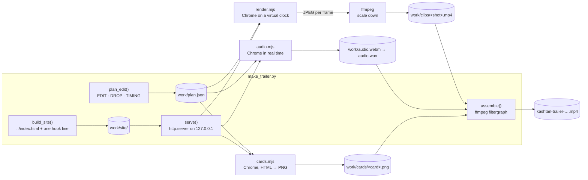

# Trailer architecture

How the trailer scripts fit together. [README.md](README.md) covers how to run and change them. This file covers
what each part does, what they agree on, and why it's built this way.

## The shape of it

One Python driver plans the cut and orchestrates. Three Node scripts each drive their own headless Chrome running
a lightly patched copy of the game. ffmpeg does all the video and audio work.



The stages run one after another: pictures, sound, captions, assembly. They share `work/`, and the sound pass has
to run in real time. Two runs must never use the same work folder at once.

## Processes

| process | started by | lives for | notes |
|---|---|---|---|
| `make_trailer.py` | you | the whole run | Plans the cut, prepares `work/`, starts and stops everything else, runs the final ffmpeg. |
| `python -m http.server` | `serve()` | the whole run | Serves `work/site/` on 127.0.0.1 at a free port (or `--port`). It's stopped in a `finally`, even on failure. |
| `node render.mjs` | the driver | the pictures stage | One headless Chrome (Metal GPU), plus one ffmpeg child per shot fed through a pipe. |
| `node audio.mjs` | the driver | the length of the trailer | One headless Chrome, playing the cut in real time. |
| `node cards.mjs` | the driver | seconds | One headless Chrome, screenshotting HTML. |
| `ffmpeg` | the driver | assembly | One filtergraph: crossfades, overlays, fades, audio processing, final encode. |

Each Chrome gets its own profile in `work/chrome-<tag>`, so no state carries between stages. `lib.mjs` holds what
the three Node scripts share:
- **`loadPuppeteer()`:** uses a local `node_modules/puppeteer` if there is one, else the global install.
- **`launch()`:** starts Chrome with Metal ANGLE, the GPU blocklist ignored and autoplay allowed. `CHROME=…`
  overrides which Chrome.
- **`openGame()`:** opens the game, waits for it to start, then lets it settle for 6 s.

## The contract: `work/plan.json`

The driver decides everything once and writes it down. The scripts read only this file, plus `shots.js` and
`cards.mjs`.

| field | meaning |
|---|---|
| `width`, `height`, `fps` | the output frame and rate |
| `supersample` | the device pixel ratio the frames are drawn at, 1 or 2 |
| `layout` | `landscape`, `scope`, `portrait` or `square`, chosen from the aspect ratio |
| `jpegq` | JPEG quality of the frames passed from Chrome to ffmpeg (0.94, or 0.97 with `--best`) |
| `port`, `site` | where the patched game is served from, and its folder |
| `xf`, `total` | the default crossfade and the exact length |
| `shots[]` | per shot: `name`, `frames`, `dur`, `start` (on the trailer's timeline), `xf` (fade in from the previous shot), `move` (fraction of the shot over which the camera moves; after that it holds), `card` |
| `cards[]` | per caption: `card`, `in`, `out`, `fade` (seconds on the trailer's timeline) |

## The game side

### The patched copy

`build_site()` copies `../index.html` into `work/site/` and inserts one line just before the game starts its frame
loop. In essence:

```js
window.__T = new Proxy({}, { get: (_, k) => eval(k), set: (_, k, v) => eval(k + ' = v') });
```

The game is a single ES module, and its variables live in module scope. A direct `eval` inside that module can
read and assign them, so `T.S = 1.65` sets the game's own season, and `T.cat`, `T.fire`, `T.CHESS` or
`T.tallHouse()` work as they do in the game's own code. Nothing else in the game is changed. `models/` is a symlink
to the real one.

The game is opened with its debug switches `?s=1.62&tod=0.36&noui`. `s` skips the title screen and marks the game
started (without starting its audio). `noui` hides every DOM overlay, leaving only the canvas.

### Two hooks in the game's frame loop

- **`window.__camLock`** is read at the end of every frame, just before rendering. If set, it returns
  `[position, yaw, pitch]` and the camera is put there. Shots drive the camera through it.
- **`mode = 'free'`** is a mode none of the game's movement code handles. With it the walking, climbing and window
  logic leave the camera alone. The exceptions:
  - **`window`:** desk shots use it, because the desk lamp lights the room only in that mode.
  - **`walk`:** the bike shot uses it, because the bike steers and carries the eye.

### `shots.js`

This runs in the page after load. It defines:

- **`SHOTS[]`**, entries of `{ name, setup(), cam(u), warm?, acam(u)? }`.
  - **`setup()`:** puts the world in the state the shot needs. It always starts with `world({...})`, which sets
    season, time of day, weather and lens, and resets every transient thing a previous shot could leave behind:
    falling leaves, conkers, the fire, snowmen, the cat, held keys, the window, the lamp.
  - **`cam(u)`:** gives the camera at $u \in [0, 1]$.
  - **`warm`:** frames, counted at 30 fps, to run before the first kept frame.
  - **`acam(u)`:** where the sound pass listens from, if not from where the shot looks.
- **`SHOT_BEGIN(i)`** and **`SHOT_END()`**. These run setup, install the `__camLock` closure, and tidy up after a
  shot (keys released, bike parked, near plane back).
- **`__setU(u, f)`**. The Node side calls it before each step to tell the camera closure where in the shot it is.
- **Camera helpers:** `look`, `vmix`, `ease`, `orbit`, `tiltUp`.
- **`world()`**, which also sets the lens per layout (see below).
- **`A()`**. It's true during the sound pass, where a few shots behave differently: the chess game isn't started,
  and the bike rings its bell.

`shots.js` knows nothing about durations. A shot only knows `u`, so the planner can stretch or shrink it freely.

## Planning the cut: `plan_edit()`

There are four inputs:
- **`EDIT`:** the shots in order, each with a natural length, a caption, and whether it belongs to the extended cut
  only.
- **`DROP`:** the order in which shots leave.
- **`TIMING`:** per-shot `hold` and slow `fade`.
- **`XF`**, the 0.6 s default crossfade.

Each shot contributes stretchable seconds `d·k`, where `k` is one factor shared by the whole cut, plus fixed
seconds:
- **Its own hold and slow fade-out**, from `TIMING`.
- **Extra time after a slow fade.** If the shot before it fades in slowly, it gets `fade − XF` more, so the long
  crossfade doesn't eat into its own time on screen (or its caption).

Shots overlap by the crossfade into the next one:

$$\text{total} = k\sum_i d_i + \sum_i \text{fixed}_i - \sum_{i<n} \text{fade}_i$$

The planner works in four steps:

1. **Drop.** Walk `DROP`. An extended-only shot stays only if every shot still fits at full length (`k = 1`). A
   standard shot stays as long as everything fits at $k \ge$ `MIN_STRETCH` (0.85). So up to the standard cut's natural
   length you get exactly the standard cut. Above it, extended shots join one by one, and below it, standard shots
   leave one by one.
2. **Stretch.** Solve the formula for `k` so the total comes out at the requested duration.
3. **Frames.** Each shot gets `round(seconds · fps)` frames. The rounding remainder is carried into the next shot,
   so the total lands on the exact length, not a few hundred milliseconds off.
4. **Captions.** A caption comes in once the fade into its shot is over and leaves as the next shot starts to fade
   in. If that leaves it less than `MIN_CAPTION` (2 s), it's dropped. The title card comes in at 43% of the last
   shot and stays to the end.

The planner is pure Python with no I/O, so `plan_edit(duration, fps)` can be called on its own to check a cut
without rendering anything.

## The pictures: `render.mjs`

### The virtual clock

Before any page script runs, `render.mjs` injects a shim:
- **`performance.now()`** returns `base + vt` once the virtual clock is on.
- **`requestAnimationFrame`** queues its callback instead of handing it to the browser.
- **`__step(ms)`** advances `vt` and runs the queued callbacks, which draws exactly one game frame.

The game's own clock (`THREE.Clock`) reads `performance.now()`. So every frame is exactly 1/fps after the last,
however long it took to draw: 5 ms or 500 ms gives the same motion. When the virtual clock takes over, any frame
the browser was about to draw is handed to the queue. Otherwise the first step after loading drew nothing and the
first frame came out black.

The game's timers (`setTimeout`, captions, fades) still run on real time, but `noui` hides their DOM output and no
shot depends on them.

### Per shot

1. **`SHOT_BEGIN(i)`**, then `warm × fps/30` steps that aren't kept.
2. **For each frame `f`:**
   - `u = min(1, (f / (frames−1)) / move)`, so the camera finishes its move at `move` and holds after.
   - `__setU(u)`, then `__step(1000/fps)`.
   - The canvas is read with `toDataURL('image/jpeg', jpegq)` in the same task as the draw, before the browser
     composites and clears it.
   - A 32×18 probe checks the frame isn't wholly black. If it is, it's drawn again, up to three times.
3. **The JPEG goes down a pipe** to an ffmpeg process per shot: `image2pipe` (MJPEG) in, Lanczos scaling from
   `width·supersample` to `width`, then x264 at CRF 6, 4:4:4, `veryfast` into `work/clips/<shot>.mp4`. Near-lossless,
   so the only real compression is the final encode.
4. **`SHOT_END()`.**

`stills` mode runs the same loop but keeps only frames `0`, the middle and the last, as JPEGs in `work/stills/`. The
driver then tiles them into contact sheets.

## The sound: `audio.mjs`

The game's music is generative. It schedules notes on the Web Audio clock from a 100 ms `setInterval` and can't be
stepped, so the sound pass plays the cut through once in real time at a small viewport:

- **The tap.** Before the page loads, `AudioNode.prototype.connect` is wrapped. Whenever the game connects
  something to the speakers, the same node is also connected to a `MediaStreamAudioDestinationNode`. A
  `MediaRecorder` records that stream as 320 kbit/s Opus.
- **The timeline.** The plan's start times are followed on the wall clock. Each shot is switched in at the middle
  of its crossfade, and a 30 ms interval keeps `u` in step with the shot's progress. Shots with `acam` are heard
  from that position instead. The church, clock and synagogue use it to put the listener by the synagogue, whose
  violin the game plays when you come near.
- **Output.** At the end the recording comes back to Node as base64 and is written to `audio.webm`. The driver
  converts it to `audio.wav`.

The pictures and the sound come from two separate runs of the game. They agree on the scene (season, weather,
place), so ambient sounds like rain, birds and the fire follow the cut. They don't agree sample for sample, and
don't need to.

## The words: `cards.mjs`

Each caption is HTML, written as `card.html` into the served site so Google Fonts load the same way as in the game.
Chrome screenshots it with a transparent background. There are two layouts:

- **Wide** (landscape and scope): laid out for 1920×1080 and fitted to the frame. Chrome draws it larger with
  `deviceScaleFactor` for big frames; ffmpeg scales it down for small ones.
- **Tall** (portrait and square): laid out 1080 wide, with larger type. Line breaks are removed so the text wraps
  to fit, and everything stays clear of the phone apps' own overlays.

Fonts are loaded explicitly and checked. If they didn't load, the card is still made and the script says so.

## Putting it together: `assemble()`

One ffmpeg run, one filtergraph:

- **Video:**
  - Each clip is normalised (`settb`, `fps`, `setpts`).
  - The clips are chained with `xfade`, each starting at its planned `start`, each lasting its own `xf`.
  - The chain is trimmed to `total`.
  - Each card is looped to the trailer's length, its alpha faded in and out, and overlaid only between `in` and
    `out`.
  - A global fade from and to black, then the output pixel format.
- **Audio:** trimmed to the trailer, then a gentle compressor, `loudnorm` to −16 LUFS (true peak −1.5 dB), and fades
  in and out.
- **Encoding:**
  - **H.264** by default: High profile, `slow`, CRF 16. With `--best`: `slower`, `film` tuning, CRF 12.
  - **HEVC** (10-bit Main 10, tagged `hvc1`, x265 `slow`) for frames larger than H.264 plays on most machines,
    above 4096×2304.
  - Every output is tagged BT.709, with the header at the front of the file (`+faststart`).

## Layouts and lenses

The layout is chosen from the frame's aspect ratio. It decides the caption layout (`cards.mjs`) and the lens
(`world()` in `shots.js`):

| layout | aspect | captions | lens |
|---|---|---|---|
| landscape | wider than tall, up to 2.1:1 | wide | the shot's `fov` (vertical, for 16:9) |
| scope | wider than 2.1:1 | wide | sees 15% more across than 16:9, less above and below |
| portrait, square | as tall as wide, or taller | tall | `tallFov`, or 1.3× `fov`, capped at 75° |

The camera's `fov` is vertical, so the same lens sees a different amount across at each aspect ratio. Keeping the
16:9 lens would make a tall frame tunnel-like and a scope frame stretched at the edges.

## What is and isn't reproducible

- **Reproducible:** timing. Every frame is at its exact time, every shot starts at its planned frame, and the cut
  is the same length every run.
- **Not reproducible:**
  - **Some of what happens in a shot.** The game uses its own random numbers: which branch the cat picks, where
    conkers fall, how leaves tumble.
  - **The music.** It's generative, so every sound pass is a new performance.

`--stills` shows what a run will look like before committing to a full render.

## Things that bit, and the rules they left

- **The desk lamp lights the room only in `window` mode.** Room shots must use `mode: 'window'`.
- **The first frame after the game loads could be black.** The virtual clock now takes over the pending frame, and
  a black frame is redrawn.
- **Every shot must undo the last.** Falling leaves, conkers, the fire, snowmen, a cat mid-episode or a held key
  leak into the next shot. `world()` resets them all.
- **A slow crossfade overlaps the next shot.** The planner lengthens that shot to make up for it.
- **The sound pass is live.** Nothing CPU-heavy should run beside it. The pictures stage doesn't mind contention;
  it only gets slower.
- **H.264 has a frame-size ceiling** in practice (4096×2304 on most decoders, including Apple's), which is why HEVC
  is used above it.
- **Very large frames:** WebGL on the M5 Max allows a drawing buffer up to 16384 on a side. A supersampled
  5160×2160 frame (10320×4320) fits, with 4× multisampling.

## Where to change what

| to change | look at |
|---|---|
| which shots, their order, length, captions | `EDIT`, `DROP`, `TIMING` in `make_trailer.py` |
| a camera, or the state of the world in a shot | `SHOTS` in `shots.js` |
| a caption's words or type | `CARDS` and the CSS in `cards.mjs` |
| how frames are captured | `render.mjs` |
| how the sound is captured | `audio.mjs` |
| transitions, overlays, loudness, encoding | `assemble()` in `make_trailer.py` |
| a new layout | `layout` in `main()`, `world()` in `shots.js`, the CSS choice in `cards.mjs` |
| where the trailer hooks into the game | `anchor` in `build_site()` |
